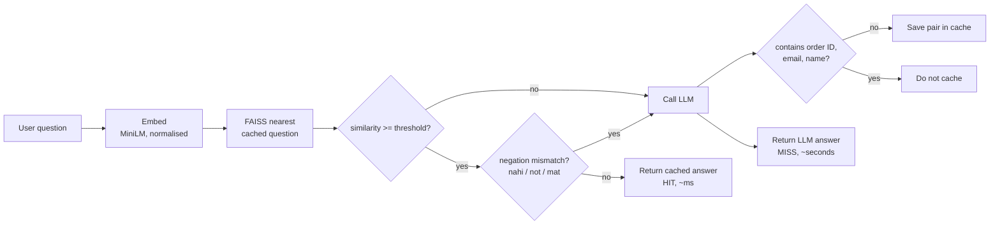

# Semantic Cache for an FAQ Bot

Answers repeat support questions from a cache when the **meaning** matches (English and Hinglish), and measures it:
hit rate, false hits, LLM calls saved and latency.

> **Measured result:** I reached a **5.0%** hit rate at threshold **0.85** with **0 false hits**.
> LLM calls fell by **3.0%**. Average latency was **1500 ms** without the cache and **1490.4 ms** with it.
> These figures use the simulated 1.5 second LLM.

## How it works



Every login gets its **own** FAISS index (tenant isolation), so one customer's cached answers are never served to another.

## Features

- Semantic cache: `paraphrase-multilingual-MiniLM-L12-v2` + FAISS (`IndexFlatIP`, cosine via normalised vectors)
- Several stored phrasings per FAQ (English + Hinglish) to fix weak Hinglish matching
- Negation guard: skips the cache when only one question has not/no/never/nahi/nhi/mat
- Hygiene: per-entry TTL (price and policy answers expire sooner) and a PII filter that never caches order IDs, phone numbers, emails
- FastAPI + JWT login, SQLite for users, logs and cache persistence across restarts
- React dashboard: chat with hit/miss badges, latency and cost dashboard (p50/p95), live **Threshold Lab** slider, negation demo
- Evaluation: labelled test set (60 paraphrases EN+Hinglish, 40 must-miss: negation traps, near-topic, out-of-domain, other e-commerce)

## Run it (Windows PowerShell, uv)

Backend:

```powershell
cd backend
uv run python smoke_test.py # quick end-to-end check
uv run python sweep.py      # prints the threshold table, saves results/sweep.md + sweep.csv
uv run uvicorn app.main:app --reload
```

Frontend (second terminal):

```powershell
cd frontend
npm install
npm run dev
```

Open http://localhost:5173, create an account, click **Run 3-way demo**.

Optional environment variables (backend): `LLM_MODE=anthropic` and `ANTHROPIC_API_KEY` for a real LLM,
`MOCK_LLM_MS`, `COST_PER_CALL_INR`, `JWT_SECRET`, `DEFAULT_THRESHOLD`, and `CORS_ORIGINS`.

## Results

I measured the following with `uv run python sweep.py`:

| threshold | hit rate % | false hits | served from cache % | avg latency ms |
|---|---|---|---|---|
| 0.50 | 51.7 | 27 | 58.0 | 665.4 |
| 0.55 | 46.7 | 24 | 52.0 | 755.4 |
| 0.60 | 36.7 | 22 | 44.0 | 875.4 |
| 0.65 | 33.3 | 16 | 36.0 | 995.4 |
| 0.70 | 26.7 | 14 | 30.0 | 1085.4 |
| 0.75 | 16.7 | 10 | 20.0 | 1235.4 |
| 0.80 | 10.0 | 1 | 7.0 | 1430.4 |
| 0.85 | 5.0 | 0 | 3.0 | 1490.4 |
| 0.90 | 1.7 | 0 | 1.0 | 1520.4 |
| 0.95 | 0.0 | 0 | 0.0 | 1535.4 |

Ablation: one phrasing per FAQ reached 15.0% with 0 false hits at 0.70.
Multiple phrasings with the guard off reached 5.0% with 0 false hits at 0.85.

The LLM is simulated by default and waits 1.5 seconds. I did not use
`LLM_MODE=anthropic` for these measurements. The Rs 0.50 per-call value is an
assumption, not a quoted provider price.

**How the numbers are defined**
- _Hit rate_ = paraphrases answered with the **correct** FAQ / 60 paraphrases.
- _False hit_ = a saved answer returned for a different question (wrong FAQ, or any "must-miss" question).
- _LLM calls down_ = share of all 100 requests served from cache.
- _Latency_ = measured lookup time + share of misses x assumed LLM time (1500 ms mock). Cost uses an **assumed** Rs 0.50 per call.
  Re-measure with `LLM_MODE=anthropic` before quoting real numbers.

## Interview talking points

- **Why semantic over exact-match:** "refund kab milega" and "paisa wapas kab aayega" never match as strings, but share one answer.
- **False-hit risk:** a wrong cached answer is worse than a slow right one, so the threshold is chosen for best hit rate at (near) zero false hits, not for the highest hit rate.
- **Negation:** embeddings score "refund milega" and "refund nahi milega" as near-identical; the guard is a cheap rule (limits: only listed words, no sarcasm or double negatives). Production: a small NLI/classifier.
- **Hinglish:** romanised Hindi is weak in multilingual MiniLM, hence multiple stored phrasings per FAQ.
- **At scale:** Redis + RedisVL `SemanticCache` or a vector DB instead of in-memory FAISS, shared TTLs and eviction, a cache per tenant, cache warming, monitoring false-hit rate with sampled human review.

## Known limitations (be upfront about these)

- Test set is small (100) and hand-written, so numbers are indicative, not production-grade. Some "must-miss" labels (e.g. "refund nahi mila abhi tak") are judgement calls.
- Name detection in the PII filter is minimal (digits, emails, "my name is").
- FAISS flat index is in memory and restored from SQLite at startup; fine for thousands of entries, not millions.
- The default `JWT_SECRET` is for development only.

## Layout

```
backend/
  app/ config.py embedder.py guards.py cache.py llm.py db.py auth.py evaluate.py main.py
  data/ faqs.json test_set.json
  sweep.py smoke_test.py
frontend/
  src/ App.jsx api.js components/{Login,Chat,Dashboard,ThresholdLab,GuardDemo}.jsx
```
